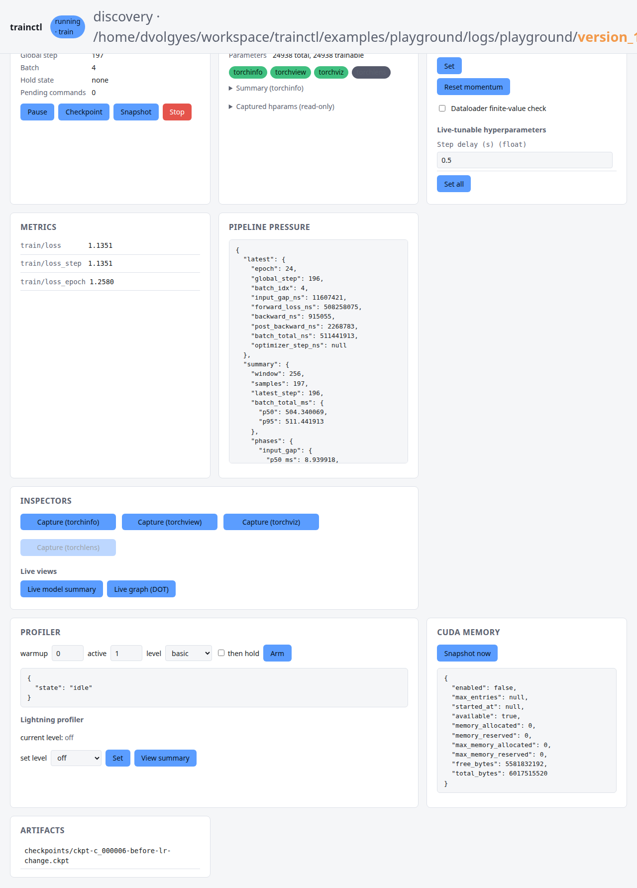
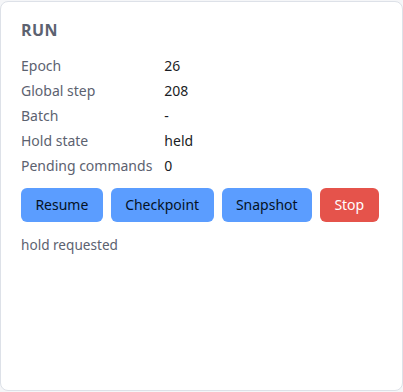
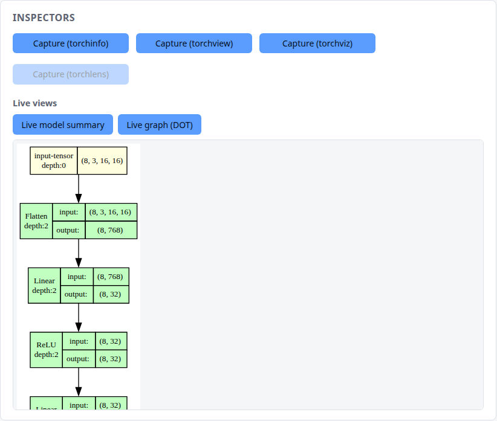
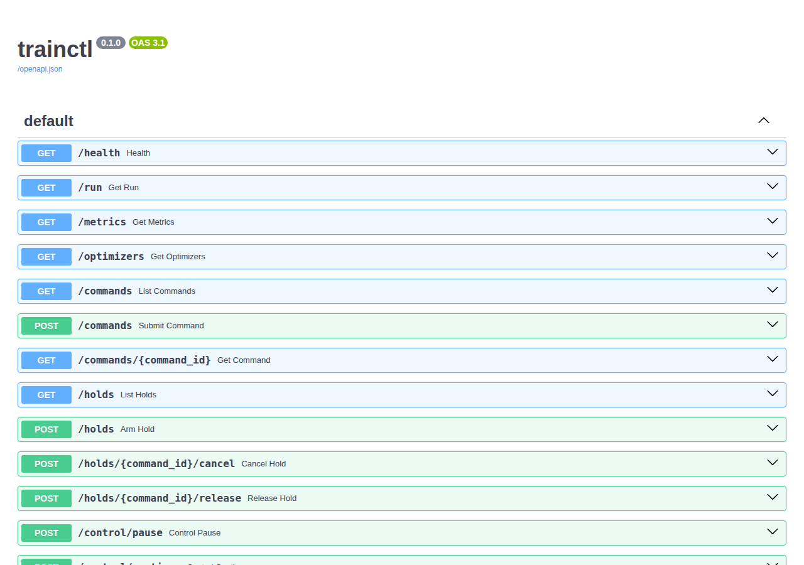

# midrun

midrun lets you look inside a running PyTorch Lightning training job and steer it without a restart. You add one mixin
class to your `LightningModule`. While the job runs, you get:

- a web dashboard and a REST API (pause, resume, stop, checkpoint, change the learning rate or a hyperparameter, capture
  model graphs and summaries);
- a read-only filesystem view of the run (`cat procfs/state/global-step`);
- an artifact store for checkpoints, snapshots and debug captures;
- shell hooks: scripts that run at Lightning callbacks, enabled with `chmod +x`.

The REST API listens on `127.0.0.1` and has no authentication. In a distributed run, the `torch.distributed.debug`
server listens on all network interfaces (see [Limits](#limits)).

## Install

midrun needs Python 3.12 or later and Linux. The filesystem view needs FUSE (`/dev/fuse` and `fusermount3`).

```sh
uv add "midrun @ git+https://github.com/dvolgyes/midrun"
# optional model inspectors (torchview, torchviz, torchinfo, torchlens):
uv add "midrun[inspectors] @ git+https://github.com/dvolgyes/midrun"
```

For work on midrun itself:

```sh
git clone https://github.com/dvolgyes/midrun && cd midrun
uv sync
```

## Quickstart: add the mixin to your model

Put `MidrunMixin` before `LightningModule` in the base classes. Give midrun options as keyword arguments to
`super().__init__()`.

```python
import lightning.pytorch as L
import torch
from torch import nn
from torch.utils.data import DataLoader, TensorDataset

from midrun import MidrunMixin


class TinyRegressor(MidrunMixin, L.LightningModule):
    # Optional: attributes that you can change while the run is live.
    midrun_tunable_hparams = {"hparams.l2": {"min": 0.0, "max": 1.0}}

    def __init__(self, lr: float = 1e-2, l2: float = 0.0) -> None:
        super().__init__()  # midrun options go here as keyword arguments
        self.save_hyperparameters()
        self.net = nn.Sequential(nn.Linear(8, 32), nn.ReLU(), nn.Linear(32, 1))

    def training_step(self, batch, batch_idx):
        x, y = batch
        loss = nn.functional.mse_loss(self.net(x), y)
        loss = loss + self.hparams.l2 * sum(p.pow(2).sum() for p in self.parameters())
        self.log("train/loss", loss, prog_bar=True)
        return loss

    def configure_optimizers(self):
        return torch.optim.SGD(self.parameters(), lr=self.hparams.lr)


if __name__ == "__main__":
    data = TensorDataset(torch.randn(4096, 8), torch.randn(4096, 1))
    trainer = L.Trainer(max_epochs=100, accelerator="cpu")
    trainer.fit(TinyRegressor(), DataLoader(data, batch_size=32))
```

Run it with `uv run python train.py`. Nothing else changes in your training code.

If your model overrides one of these Lightning hooks, call `super()` in your override, because midrun uses them:
`setup`, `teardown`, `configure_callbacks`, `on_fit_start`, `on_fit_end`, `on_train_batch_start`, `on_train_batch_end`,
`on_train_epoch_end`, `on_validation_epoch_end`, `on_before_backward`, `backward`, `on_after_backward`,
`on_before_optimizer_step`.

## Where to find the run

midrun puts its files in a directory that belongs to this run only. We call it the run directory, `$RUN` below:

- With a `TensorBoardLogger` or a `CSVLogger` as the first logger, the run directory is the Trainer's log directory (for
  example `lightning_logs/version_0/`), next to the files of your logger.
- With any other first logger (for example W&B or MLflow), the run directory is `<save_dir>/midrun/<version>`. The
  version is the logger's run id. midrun replaces each character other than letters, digits, `.`, `_` and `-` with `_`,
  and removes leading dots. A run that resumes with the same logger version uses the same directory.
- Without a logger, or when the logger has no version, the run directory is `<default_root_dir>/midrun/<run-id>`. The
  run id is new for each model instance (`run-<time>-<pid>-<random>`), so sequential `fit()` calls on the same model
  share the directory, and a new model or a new process gets a new one.

In a distributed run, all ranks use the directory that rank zero selects.

**Breaking change:** older versions used `trainer.log_dir` for every logger. For a W&B or MLflow logger, and without a
logger, that directory is the same for all runs, so a new run reused the hooks, the marker and the log of an earlier
run. Move or delete the old `hooks/`, `procfs/`, `artifacts/`, `midrun-hooks-state.json` and `midrun.log` there if you
do not need them.

```text
$RUN/
├── procfs/                      read-only live view of the run (FUSE mount, exists while the run is live)
├── artifacts/                   checkpoints/, snapshots/, debug/
├── hooks/                       light/ and heavy/ shell hooks, all disabled at start
├── midrun-hooks-state.json
└── midrun.log                 midrun log, including hook output
```

The REST port is 8090. If 8090 is in use, midrun tries the next ports, `rest_port_search` ports in total. In a
distributed run with the PyTorch distributed debug server on, rank zero starts REST and the debug server as a pair
instead: it adds the same offset, a multiple of 100, to both base ports (8090 and 25999), and tries
`paired_port_search_attempts` offsets. `rest_port_search` and `torch_debug_port_search` do not apply in that case. The
address that the run actually uses is in `procfs/meta/rest/url`:

```sh
RUN=lightning_logs/version_0               # the run directory
URL=$(cat $RUN/procfs/meta/rest/url)    # for example http://127.0.0.1:8090
curl -s $URL/health
```

## Debug in the browser

Open the REST address (`$URL/`) in a browser. The dashboard shows the run state, controls, metrics, pipeline timing,
CUDA memory, the profiler, artifacts and model inspectors. The page refreshes every 15 seconds; the refresh button
updates it immediately.



**Pause** holds the training at the next safe point, before the optimizer step. While the run is held, you can make a
checkpoint, change the learning rate or a tunable hyperparameter, and then click **Resume**.



The inspectors panel shows model views that midrun captures at the next optimizer step, for example the live model graph
(needs `midrun[graphs]`). Capture these views while the run is not held: they wait for the next optimizer step and fail
after 30 seconds.



The full API, with a "Try it out" form for each route, is at `$URL/docs`.



To use the dashboard from another computer, forward the port over SSH:

```sh
ssh -L 8090:127.0.0.1:8090 <training-host>
```

The REST API accepts a request only when its `Host` header names this machine, so that a web page cannot read the API
through DNS rebinding. Other names get status 400 (`Invalid host header`). The accepted names are `localhost`,
`127.0.0.1`, `[::1]`, `rest_host` when it is not `0.0.0.0` or `::`, the host name and the fully qualified name of the
machine, the server address in `SSH_CONNECTION` (the address that you connected to with SSH), and the IP addresses in
the `MIDRUN_WHITELIST_IP` environment variable, separated by commas (for example `203.0.113.9,2001:db8::9`). To open the
API under another name, for example through a reverse proxy, add the name to `rest_allowed_hosts`. The check reads the
environment when REST starts. midrun does not start REST when an entry of `MIDRUN_WHITELIST_IP` is not an IPv4 or IPv6
address.

## Control the run with REST

```sh
curl -s -X POST $URL/control/pause                 # hold at the next safe point
curl -s $URL/holds                                 # hold state
curl -s -X POST $URL/checkpoints -H 'Content-Type: application/json' -d '{"label": "before-lr-change"}'
curl -s -X POST $URL/commands -H 'Content-Type: application/json' \
    -d '{"kind": "set_learning_rate", "args": {"value": 5e-4}}'
curl -s -X POST $URL/commands -H 'Content-Type: application/json' \
    -d '{"kind": "set_hparam", "args": {"name": "hparams.l2", "value": 0.01}}'
curl -s -X POST $URL/control/continue              # release the hold
curl -s -X POST $URL/control/stop                  # stop the training cleanly
```

Each command returns an id. Use `GET $URL/commands/<id>` to see its status and result. The status is `queued`,
`executing`, `succeeded`, `failed`, `cancelled` or `expired`. A command that is still queued when its stage stops
becomes `expired`, with an error. midrun keeps the last 1000 finished commands, so `GET $URL/commands/<id>` returns
status 404 for an older id.

By default a command runs at the next point where it is safe. To run it later, add `execution.when`:

```json
{
  "kind": "checkpoint",
  "args": {
    "label": "epoch-5"
  },
  "execution": {
    "when": {
      "safe_point": "train_epoch_end",
      "epoch": 5
    }
  }
}
```

Safe points are `train_batch_end`, `train_epoch_end`, `validation_epoch_end`, `before_optimizer_step` and `fit_end`.
Instead of `epoch`, you can give `global_step`. Without `safe_point`, the `epoch` or `global_step` condition applies at
any safe point. With only `safe_point`, the command runs at the next occurrence of that safe point. The REST API rejects
any other `when` value with status 422.

| Command kind | What it does |
| -- | -- |
| `hold`, `stop` | Pause or stop the training. |
| `checkpoint`, `snapshot` | Write a checkpoint or a runtime snapshot to `artifacts/`. |
| `set_learning_rate`, `reset_momentum` | Change optimizer state. |
| `set_hparam` | Change a tunable hyperparameter (see below). |
| `set_dataloader_finite_check` | Turn the NaN/Inf check of each batch on or off. |
| `save_current_batch`, `save_current_loss`, `save_partial_gradients`, `save_optimizer_summary` | Save training data for offline debugging. |
| `release_exception` | End the hold after a backward exception that midrun caught; the exception is then raised again. |
| `torchinfo_capture`, `torchview_capture`, `torchviz_capture`, `torchlens_capture` | Capture a model summary or graph (optional extras). |
| `profile`, `set_lightning_profiler` | Profile some training steps. |

The REST API checks the kind and the arguments of a command when it receives the command. It rejects an unknown kind, a
missing or unknown argument, and a value of the wrong type with status 422. The type check is strict: the string
`"false"` is not a boolean, and `7.9` and `7.0` are not integers. The only conversion is from an integer to a float: for
a float argument, `{"value": 1}` is accepted and becomes `1.0`. Every invalid argument, in any route, gets status 422
with a list of errors: `{"detail": [{"loc": ["body", ...], "msg": "...", "type": "..."}]}`.

While the run is held, only some command kinds run. `GET $URL/holds` lists the other queued commands under `waiting`.
They run after the hold ends. After `release_exception` they never run, because the run then ends with the exception.
During an exception hold, `active` in `GET $URL/holds` is `null`, and `exception` shows the exception with the same
fields as in `GET $URL/run`. Otherwise, `exception` is `null`. `release_exception` returns status 409 when no exception
hold is active. `POST $URL/holds/<id>/cancel` cancels only a hold that is not active yet. `POST $URL/control/continue`
releases the active hold, and also cancels a pause from `POST $URL/control/pause` that is not active yet; it lists the
cancelled ids under `cancelled_holds`. A hold that becomes due while another hold is active joins it: its result names
the active hold under `active_hold_id`, the active hold lists it under `joined_ids`, and a release with either id
releases the run. After a stop has run, a new hold (`POST $URL/holds`, `POST $URL/control/pause` or a `hold` command)
returns status 409 until the next `trainer.fit`, `validate` or `test` on the same model starts.

Other routes: `/run`, `/metrics`, `/optimizers`, `/artifacts`, `/telemetry/pipeline`, `/inspectors`,
`/debug/cuda-memory/snapshot`, `/files/<path>` (the same tree as `procfs/`).
`GET $URL/debug/cuda-memory/history?enabled=true` starts to record the CUDA allocator history for the snapshots. Without
`max_entries`, it keeps the last 100_000 entries.

`/run`, `/metrics` and `/optimizers` show the values of the last safe point (before each optimizer step and at each
training batch end), as floats. At each safe point, midrun copies the CUDA metric values and learning rates to the host
without a wait for the device. Only a read waits for that copy, so the training loop never waits for the device because
of midrun. A metric that is not a real scalar, such as a vector or a complex tensor, is not shown.

### Model inspectors

The four inspector commands and the live files `model/summary-live.txt` and `model/graph.dot` run one forward pass on
the in-flight batch, on rank 0 only. In an exception hold, `torchviz_capture` draws the failed loss instead, without a
forward pass. The forward pass runs in eval mode: dropout is off and batch norm uses its running statistics, so the
result can differ from the training forward pass. Gradients are off, except for `torchviz_capture`, which needs the
autograd graph. After the capture, each module gets back its training mode.

Under a strategy that shards the parameters (`FSDPStrategy`, `ModelParallelStrategy`, `DeepSpeedStrategy`), or when a
parameter is a wrapper tensor such as a `DTensor`, a forward pass on rank 0 alone would wait for collectives that the
other ranks do not join. In that case the inspectors refuse to run: the command fails with a `refused` error, and a read
of a live file fails. The training continues.

### Tunable hyperparameters

`set_hparam` changes only the attributes that the model declares in `midrun_tunable_hparams`:

```python
midrun_tunable_hparams = ["hparams.dropout"]  # a list of paths
midrun_tunable_hparams = {
    "hparams.l2": {"min": 0.0, "max": 1.0, "label": "L2"}
}  # or paths with limits
```

The declared values are in `procfs/model/tunable-hparams.json`. A new value must have the type of the current value, but
an integer is also a valid float. A float value must be finite.

## Read the run as files

`procfs/` is a read-only FUSE mount. Use any tool that reads files:

```sh
cat $RUN/procfs/state/status $RUN/procfs/state/epoch $RUN/procfs/state/global-step
cat $RUN/procfs/state/metrics/index.json
cat $RUN/procfs/model/summary.txt
ls  $RUN/procfs/meta/ranks/
watch -n1 cat $RUN/procfs/state/pipeline/summary.json
```

| Directory | Contents |
| -- | -- |
| `state/` | status, stage, epoch, global step, metrics, hold state, pipeline timing, CUDA memory |
| `meta/` | run id, versions, REST and debug-server addresses, ranks, artifact path |
| `model/` | class, hyperparameters, summary, tunable hyperparameters, inspector results |
| `debug/pytorch/` | `torch.distributed.debug` status |

`model/summary-live.txt`, `model/graph.dot` and `model/lightning-profiler-summary.txt` are made on demand at the next
optimizer step. A read of these files waits for that step and fails after 30 seconds if the training is held. When no
Lightning profiler is set, `model/lightning-profiler-summary.txt` does not wait. A read at the `pytorch` level ends the
PyTorch profile, so midrun then sets a new `PyTorchProfiler`, and the file says so.

When the run ends or fails, midrun unmounts `procfs/`. If the training process is killed (for example with `kill -9`), a
small watcher process unmounts `procfs/` when the training process exits. If the mount still stays and shows
`Transport endpoint is not connected`, remove it with:

```sh
fusermount3 -uz $RUN/procfs
```

A new run also removes a stale midrun mount at its mountpoint. midrun does not mount on a directory that contains files
or another mount.

## Shell hooks

midrun makes a script for each Lightning callback in `hooks/light/` and `hooks/heavy/`. All scripts are disabled at
start. To enable a script, edit it and set its execute bit; to disable it, remove the execute bit. The change applies at
the next callback, without a restart.

```sh
cat > $RUN/hooks/light/on_train_batch_end.sh <<'EOF'
jq -c '{step: .global_step, batch: .batch_idx}' "$1"
EOF
chmod +x $RUN/hooks/light/on_train_batch_end.sh
tail -f $RUN/midrun.log
```

A light hook gets a JSON description of the callback arguments. A heavy hook also gets the tensors as `.npy` files. The
hook runs on the training thread, so the training waits for it. For the payload format, timeouts and limits, see
[docs/hooks.md](docs/hooks.md).

## Options

Give these as keyword arguments to `super().__init__()`. The [MidrunConfig docstring](midrun/config.py) has the full
description of each option.

| Option | Default | Purpose |
| -- | -- | -- |
| `midrun_enabled` | `True` | Master switch for all services. |
| `rest_enabled`, `rest_host`, `rest_port`, `rest_port_search` | `True`, `127.0.0.1`, `8090`, `100` | REST API and dashboard. |
| `rest_allowed_hosts` | `()` | Extra `Host` header names for the REST API, for example a reverse proxy. |
| `fuse_enabled`, `fuse_mountpoint` | `True`, `$RUN/procfs` | Read-only filesystem view. |
| `artifact_dir` | `$RUN/artifacts` | Checkpoints, snapshots, debug captures. |
| `torch_debug_enabled`, `torch_debug_port` | `True`, `25999` | `torch.distributed.debug` server; starts only when torch.distributed is initialized. |
| `hooks_enabled`, `hooks_source_dir`, `hooks_timeout_s`, `hooks_rank_policy` | `True`, `None`, `None`, `"rank_zero"` | Shell hooks; see [docs/hooks.md](docs/hooks.md). |
| `pipeline_pressure_enabled`, `pipeline_pressure_window` | `True`, `256` | Per-batch phase timing. |
| `break_on_backward_exception` | `True` | Hold the run when `backward()` raises, so that you can inspect the batch. |
| `dataloader_finite_check_enabled` | `False` | Check each batch for NaN/Inf (slow). |
| `optimizer_surgery_enabled` | `True` | Allow `reset_momentum` and per-group learning rates. |
| `inspection_strict` | `False` | Raise instead of a warning when a service or the hooks tree does not start. |

## Limits

- REST, the dashboard and the FUSE view run only on global rank zero. In a distributed run, rank zero sends the due
  commands to the other ranks at each safe point, through a separate gloo process group. `stop`, `checkpoint`,
  `set_learning_rate`, `reset_momentum`, `set_dataloader_finite_check` and `set_hparam` run on every rank, and a hold
  stops every rank. The other commands run on rank zero only. Each safe point costs one small broadcast, about 0.5 ms on
  two local ranks. If a command on rank zero takes longer than 30 minutes, the other ranks time out.
- After a backward exception in a distributed run, only rank zero holds. The other ranks raise the exception at once, so
  Lightning soon stops the job.
- midrun does not support `strategy="ddp_spawn"` or the other spawn-based strategies, because they pickle the model. Use
  `strategy="ddp"`.
- In a distributed run, the `torch.distributed.debug` server listens on all network interfaces and has no
  authentication. It shows stack traces and process dumps of all ranks. On a shared network, set
  `torch_debug_enabled=False`.
- The REST API has no authentication and listens on `127.0.0.1`. Anybody with a shell on the training machine can
  control the run. Do not bind it to a public interface. A web page in your browser can still send requests that change
  the run (cross-site request forgery), but the `Host` check stops it from reading the answers.
- midrun starts its services in `setup` and stops them in `teardown`, so they exist only while `fit`, `validate`, `test`
  or `predict` runs.

## Example

`examples/playground/run.py` is a slow CPU training run for interactive tests:

```sh
uv run --group examples python -m examples.playground.run
```

## Development

```sh
uv sync --all-extras
uv run pytest -n 8
pre-commit run --all
```
