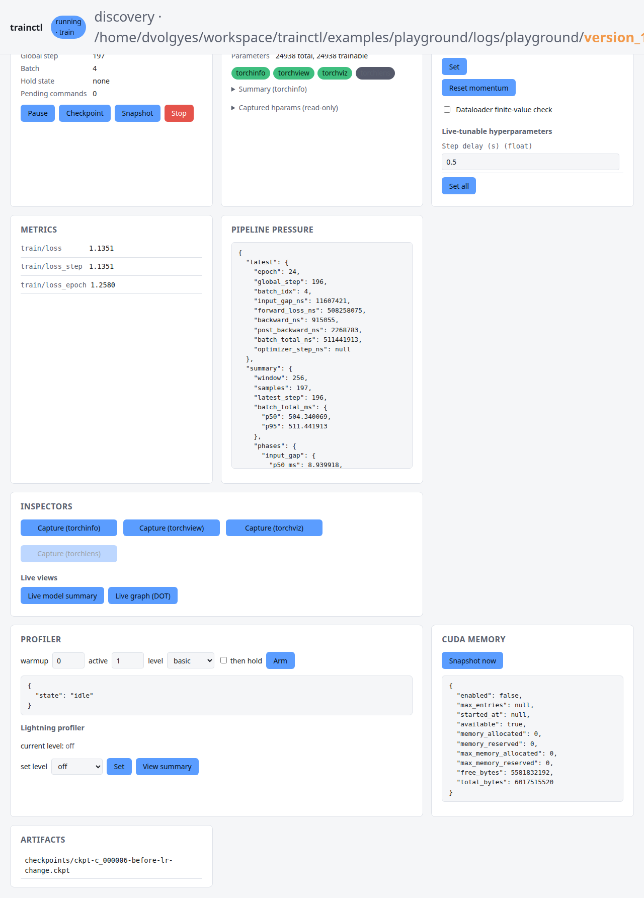
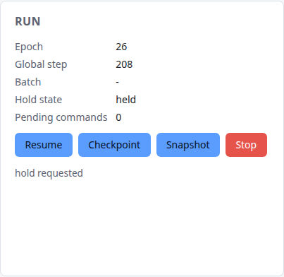
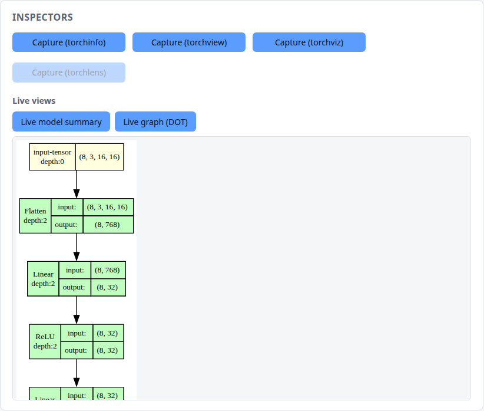
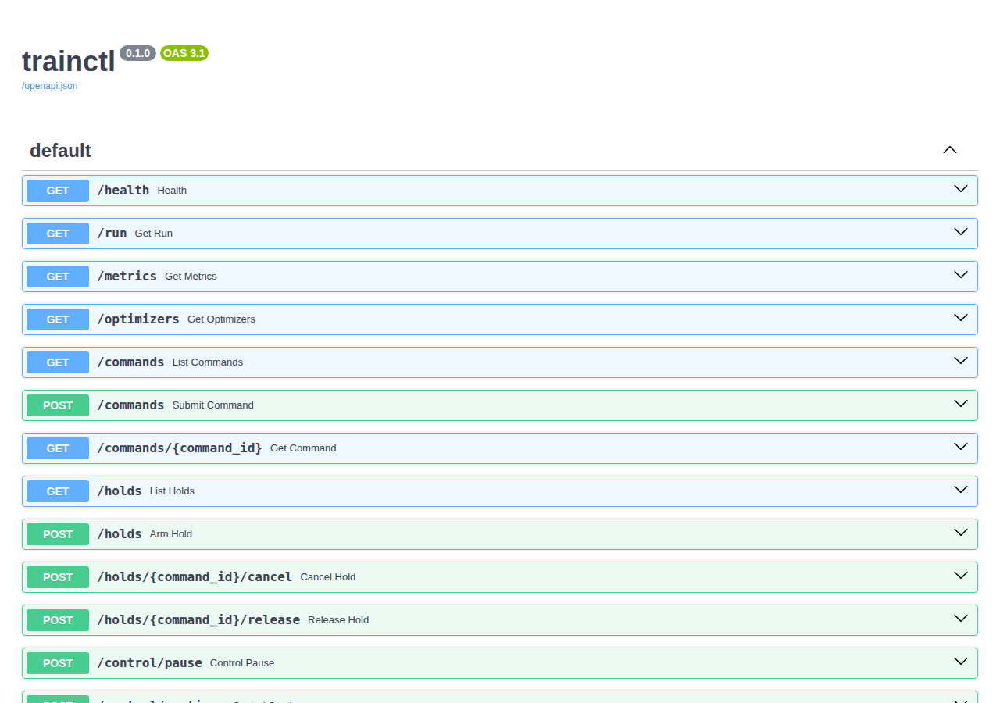

# midrun

midrun lets you look inside a running PyTorch Lightning training job and steer it without a restart. You add one mixin
class to your `LightningModule`. While the job runs, you get:

- a web dashboard and a REST API (pause, resume, stop, checkpoint, change the learning rate or a hyperparameter, capture
  model graphs and summaries);
- a read-only filesystem view of the run (`cat procfs/state/global-step`);
- an artifact store for checkpoints, snapshots and debug captures;
- shell hooks: scripts that run at Lightning callbacks, enabled with `chmod +x`.

The REST API listens on `127.0.0.1` by default and has no authentication. Other users on the training host can control
the run. The distributed PyTorch debug server listens on all interfaces; disable it on a shared network (see
[Limits](#limits)).

## Install

midrun needs Python 3.12 or later and Linux. The filesystem view needs FUSE (`/dev/fuse` and `fusermount3`).

```sh
uv add "midrun @ git+https://github.com/dvolgyes/midrun"
# optional model inspectors (torchview, torchviz, torchinfo, torchlens):
uv add "midrun[inspectors] @ git+https://github.com/dvolgyes/midrun"
```

For work on midrun itself:

```sh
git clone https://github.com/dvolgyes/midrun && cd midrun
uv sync
```

## Quickstart: add the mixin to your model

Put `MidrunMixin` before `LightningModule` in the base classes. Give midrun options as keyword arguments to
`super().__init__()`.

```python
import lightning.pytorch as L
import torch
from torch import nn
from torch.utils.data import DataLoader, TensorDataset

from midrun import MidrunMixin


class TinyRegressor(MidrunMixin, L.LightningModule):
    # Optional: attributes that you can change while the run is live.
    midrun_tunable_hparams = {"hparams.l2": {"min": 0.0, "max": 1.0}}

    def __init__(self, lr: float = 1e-2, l2: float = 0.0) -> None:
        super().__init__()  # midrun options go here as keyword arguments
        self.save_hyperparameters()
        self.net = nn.Sequential(nn.Linear(8, 32), nn.ReLU(), nn.Linear(32, 1))

    def forward(self, x: torch.Tensor) -> torch.Tensor:
        return self.net(x)

    def training_step(self, batch, batch_idx):
        x, y = batch
        loss = nn.functional.mse_loss(self(x), y)
        loss = loss + self.hparams.l2 * sum(p.pow(2).sum() for p in self.parameters())
        self.log("train/loss", loss, prog_bar=True)
        return loss

    def configure_optimizers(self):
        return torch.optim.SGD(self.parameters(), lr=self.hparams.lr)


if __name__ == "__main__":
    data = TensorDataset(torch.randn(4096, 8), torch.randn(4096, 1))
    trainer = L.Trainer(max_epochs=100, accelerator="cpu")
    trainer.fit(TinyRegressor(), DataLoader(data, batch_size=32))
```

Run it with `uv run python train.py`. For a batch such as `(input, target)`, live inspectors pass `input` to the model.
If the batch does not match `forward()`, define `midrun_forward_input(self, batch)` on the model. For example, return
`batch["image"]` when a dictionary holds both the image and its label.

If your model overrides one of these Lightning hooks, call `super()` in your override, because midrun uses them:
`setup`, `teardown`, `configure_callbacks`, `on_fit_start`, `on_fit_end`, `on_train_batch_start`, `on_train_batch_end`,
`on_train_epoch_end`, `on_validation_epoch_end`, `on_before_backward`, `backward`, `on_after_backward`,
`on_before_optimizer_step`.

## Where to find the run

midrun puts its files in a directory that belongs to this run only. We call it the run directory, `$RUN` below:

- With a `TensorBoardLogger` or a `CSVLogger` as the first logger, the run directory is the Trainer's log directory (for
  example `lightning_logs/version_0/`), next to the files of your logger.
- With any other first logger (for example W&B or MLflow), the run directory is `<save_dir>/midrun/<version>`. The
  version is the logger's run id. midrun replaces each character other than letters, digits, `.`, `_` and `-` with `_`,
  and removes leading dots. A run that resumes with the same logger version uses the same directory.
- Without a logger, or when the logger has no version, the run directory is `<default_root_dir>/midrun/<run-id>`. The
  run id is new for each model instance (`run-<time>-<pid>-<random>`), so sequential `fit()` calls on the same model
  share the directory, and a new model or a new process gets a new one.

In a distributed run, all ranks use the directory that rank zero selects.

**Breaking change:** older versions used `trainer.log_dir` for every logger. For a W&B or MLflow logger, and without a
logger, that directory is the same for all runs, so a new run reused the hooks, the marker and the log of an earlier
run. Move or delete the old `hooks/`, `procfs/`, `artifacts/`, `midrun-hooks-state.json` and `midrun.log` there if you
do not need them.

```text
$RUN/
├── procfs/                      read-only live view of the run (FUSE mount, exists while the run is live)
├── artifacts/                   checkpoints/, snapshots/, debug/
├── hooks/                       light/ and heavy/ shell hooks, all disabled at start
├── midrun-hooks-state.json
└── midrun.log                 midrun log, including hook output
```

The REST port is 8090. If 8090 is in use, midrun tries the next ports, `rest_port_search` ports in total. In a
distributed run with the PyTorch distributed debug server on, rank zero starts REST and the debug server as a pair
instead: it adds the same offset, a multiple of 100, to both base ports (8090 and 25999), and tries
`paired_port_search_attempts` offsets. `rest_port_search` and `torch_debug_port_search` do not apply in that case. The
address that the run actually uses is in `procfs/meta/rest/url`:

```sh
RUN=lightning_logs/version_0               # the run directory
URL=$(cat $RUN/procfs/meta/rest/url)    # for example http://127.0.0.1:8090
curl -s $URL/health
```

## Debug in the browser

Open the REST address (`$URL/`) in a browser. The dashboard shows the run state, controls, metrics, pipeline timing,
CUDA memory, the profiler, artifacts and model inspectors. The page refreshes every 15 seconds; the refresh button
updates it immediately.



**Set all** sends only edited fields that do not already have a command pending.

Refresh preserves unsent edits, even while an earlier submission is pending.

Once an edit succeeds, **Set all** does not send it again.

**Pause** holds the run at its next supported safe point, not necessarily before an optimizer step. While the run is
held, you can save a checkpoint, change a learning rate or hyperparameter, and click **Resume**.



The inspectors panel shows model views that midrun captures at the next optimizer step, for example the live model graph
(needs `midrun[graphs]`). Capture these views while the run is not held: they wait for the next optimizer step and fail
after 30 seconds.



The full API, with a "Try it out" form for each route, is at `$URL/docs`.



To use the dashboard from another computer, forward the port over SSH:

```sh
ssh -L 8090:127.0.0.1:8090 <training-host>
```

The REST API accepts a request only when its `Host` header names this machine, so that a web page cannot read the API
through DNS rebinding. Other names get status 400 (`Invalid host header`). The accepted names are `localhost`,
`127.0.0.1`, `[::1]`, `rest_host` when it is not `0.0.0.0` or `::`, the host name and the fully qualified name of the
machine, the server address in `SSH_CONNECTION` (the address that you connected to with SSH), and the IP addresses in
the `MIDRUN_WHITELIST_IP` environment variable, separated by commas (for example `203.0.113.9,2001:db8::9`). To open the
API under another name, for example through a reverse proxy, add the name to `rest_allowed_hosts`. The check reads the
environment when REST starts. midrun does not start REST when an entry of `MIDRUN_WHITELIST_IP` is not an IPv4 or IPv6
address.

## Control the run with REST

```sh
curl -s -X POST $URL/control/pause                 # hold at the next safe point
curl -s $URL/holds                                 # hold state
curl -s -X POST $URL/checkpoints -H 'Content-Type: application/json' -d '{"label": "before-lr-change"}'
curl -s -X POST $URL/commands -H 'Content-Type: application/json' \
    -d '{"kind": "set_learning_rate", "args": {"value": 5e-4}}'
curl -s -X POST $URL/commands -H 'Content-Type: application/json' \
    -d '{"kind": "set_hparam", "args": {"name": "hparams.l2", "value": 0.01}}'
curl -s -X POST $URL/control/continue              # release the hold
curl -s -X POST $URL/control/stop                  # stop the training cleanly
```

Each accepted command has an ID. Use `GET $URL/commands/<id>` to read its status, result and scheduling condition
(`when`). The status is `queued`, `executing`, `succeeded`, `failed`, `cancelled` or `expired`. When a stage stops,
queued commands expire and new submissions get HTTP 409 until the next stage opens. Midrun keeps the last 1000 finished
commands; a lookup for an older ID returns HTTP 404.

By default a command runs at the next point where it is safe. To run it later, add `execution.when`:

```json
{
  "kind": "checkpoint",
  "args": {
    "label": "epoch-5"
  },
  "execution": {
    "when": {
      "safe_point": "train_epoch_end",
      "epoch": 5
    }
  }
}
```

Safe points are `train_batch_end`, `train_epoch_end`, `validation_epoch_end`, `before_optimizer_step` and `fit_end`.
Standalone `validate()` processes commands at validation epoch end. `test()` and `predict()` start services but have no
command safe point. Model and tunable-hyperparameter metadata initialize at fit start, not at the start of those stages.
Instead of `epoch`, you can give `global_step`. Without `safe_point`, the condition applies at any safe point. With only
`safe_point`, the command runs at its next occurrence. The REST API rejects any other `when` value with status 422.

| Command kind | What it does |
| -- | -- |
| `hold`, `stop` | Pause or stop the training. |
| `checkpoint`, `snapshot` | Write a checkpoint or snapshot to `artifacts/`; a runtime snapshot records state at the safe point where the command executes. |
| `set_learning_rate`, `reset_momentum` | Change optimizer state. |
| `set_hparam` | Change a tunable hyperparameter (see below). |
| `set_dataloader_finite_check` | Turn the NaN/Inf check of each batch on or off. |
| `save_current_batch`, `save_current_loss`, `save_partial_gradients`, `save_optimizer_summary` | Save training data for offline debugging; a skipped batch is not an in-flight batch. |
| `release_exception` | End the hold after a backward exception that midrun caught; the exception is then raised again. |
| `torchinfo_capture`, `torchview_capture`, `torchviz_capture`, `torchlens_capture` | Capture a model summary or graph (optional extras). |
| `profile`, `set_lightning_profiler` | Profile some training steps. |

`set_learning_rate` checks every selected parameter group before changing any of them.

It rejects a rate that overflows or rounds from a positive value to zero in a group's tensor dtype.

The command result reports the rate each group actually stores.

Tensor rates are updated outside autograd.

If a tensor rate shares storage with an unselected group, only the selected group gets a replacement.

Outside inference mode, the command rejects in-place updates to inference tensors before changing any group.

For Adam and AdamW, `reset_momentum` clears only the selected first moments.

Outside inference mode, the command rejects an in-place reset of an inference tensor before changing any first moment.

If a reset replaces a shared buffer, recapture any CUDA graph that used that buffer before replay.

For fused SGD, `reset_momentum` rejects any reset that would remove a buffer from a group with multiple parameters.

Even a whole-group reset can leave buffers missing if only some parameters get gradients on the next step.

Single-parameter groups can still reset, and selecting no initialized buffers is a no-op.

The `profile` command returns a separate `capture_id` that stays the same on write retries and for truncated traces.

For the manifest, poll `GET $URL/artifacts/<capture_id>`, which returns 404 until publication.

The dashboard waits up to two minutes after arming, but there is no artifact if the profiler records nothing.

If a completed `profile` cannot write its trace, `state/profiler.json` reports `pending_publication`.

- The next batch end or stage teardown retries the write without recording more steps.
- A requested `then_hold` pauses training only after a successful batch-end write.

The REST API checks the kind and the arguments of a command when it receives the command. It rejects an unknown kind, a
missing or unknown argument, and a value of the wrong type with status 422. The type check is strict: the string
`"false"` is not a boolean, and `7.9` and `7.0` are not integers. The only conversion is from an integer to a float: for
a float argument, `{"value": 1}` is accepted and becomes `1.0`. Every invalid argument, in any route, gets status 422
with a list of errors: `{"detail": [{"loc": ["body", ...], "msg": "...", "type": "..."}]}`.

While the run is held, only immediate (`now`) commands permitted by the hold policy and batch availability can run.

`GET $URL/holds` lists queued commands that cannot run during the hold under `waiting`.

Hold commands appear under `holds` instead.

Waiting commands can run after a regular hold ends, when their scheduling conditions are met.

After `release_exception` they never run, because the run then ends with the exception.

During an exception hold, `active` in `GET $URL/holds` is `null`, and `exception` shows the exception with the same
fields as in `GET $URL/run`. Otherwise, `exception` is `null`. `release_exception` returns status 409 when no exception
hold is active. `POST $URL/holds/<id>/cancel` cancels only a hold that is not active yet.

`POST $URL/control/continue` releases any active hold and cancels any control pause still waiting to activate.

The response lists the cancelled IDs under `cancelled_holds`.

Holds selected together at a safe point share one active hold. Its `joined_ids` lists the other command IDs, and a
release with any of those IDs releases the run. A new hold submitted through `/holds` after the hold loop starts stays
queued. After a stop has run, new hold commands are refused until the next stage starts.

If an exception hold is interrupted, `/run` reports `stopping` with `exception` set to `null` before teardown.

Releasing a stale hold ID returns HTTP 404 and leaves the replacement hold active.

Other routes: `/run`, `/metrics`, `/optimizers`, `/artifacts`, `/telemetry/pipeline`, `/inspectors`,
`/debug/cuda-memory/snapshot`, `/files/<path>` (the same tree as `procfs/`).

`GET $URL/checkpoints` lists each checkpoint's `size_bytes`, modification time, and URL only after all ranks save it.

- For a single-file checkpoint, the URL downloads the file and `size_bytes` is its size.
- For a directory checkpoint, the URL is a base for known shard filenames, not an archive download.
- A directory checkpoint's `size_bytes` is its filesystem-reported size, not the sum of its contents.

Snapshots and debug captures appear only when their manifest and payloads are ready.

A directory under `/files/` is a page of links for a browser, and JSON (`path` and `entries`) for other clients.

Two CUDA `GET` routes have side effects: `/debug/cuda-memory/snapshot` writes a debug artifact, and
`/debug/cuda-memory/history?enabled=true` starts recording allocator history.

Without `max_entries`, the history keeps the last 100_000 entries.

Checkpoint staging and `checkpoints/` must be on the same filesystem.

Publication requires hard links for file checkpoints or no-replace renames for directory checkpoints.

Midrun waits for Lightning's `AsyncCheckpointIO` to finish writing before publishing a checkpoint.

Other custom writers must finish before their save method returns; Midrun cannot detect when their background work ends.

If a stage cannot initialize its artifact directory, it does not use the previous stage's directory.

`/run`, `/metrics` and `/optimizers` report scalar values from the last published snapshot, not a live device query. For
ordinary CUDA scalar publication, midrun schedules a host copy and leaves the wait to readers that need the value. This
does not make all inspection asynchronous: finite checking and heavy hooks can make training wait for the device.
Metrics that are not real scalars, such as vectors and complex tensors, are omitted.

A retained Lightning metric keeps its step, epoch and timestamp until it is logged again, even with the same value.

This applies separately to the metrics published for each validation dataloader.

Values placed directly in the callback dictionary without a Lightning producer use the publication time.

`/telemetry/pipeline` reports the optimizer step count **at batch end**. With gradient accumulation, consecutive batches
can report the same `global_step`. The rolling summary uses nearest-rank percentiles without interpolation. In each
phase, `mean_to_batch_ratio` replaces `fraction`: it divides mean phase time by mean in-batch time. The input gap occurs
*between* batches, so its ratio can exceed one.

The first timed batch of each `fit()` reports `input_gap_ns: null`; the rolling summary retains earlier samples.

A skipped batch adds no timing sample and does not reset the input gap.

For batches with multiple backward passes, `backward_ns` sums all passes and `forward_loss_ns` includes the gaps between
them.

### Model inspectors

The four inspector commands and the live files `model/summary-live.txt` and `model/graph.dot` run one forward pass on
the in-flight batch, on rank 0 only. In an exception hold, `torchviz_capture` draws the failed loss instead, without a
forward pass. An epoch end has no in-flight batch, so an inspector command, `save_current_batch` or `save_current_loss`
that is due there, or in a hold that began there, stays queued until the next batch. A `when` that names
`train_epoch_end`, `validation_epoch_end` or `fit_end` for such a command gets status 422. The forward pass runs in eval
mode: dropout is off and batch norm uses its running statistics, so the result can differ from the training forward
pass. Gradients are off, except for `torchviz_capture`, which needs the autograd graph. After the capture, each module
gets back its training mode.

Model summaries count a shared parameter once, even when multiple layers use it in the same forward pass.

Under a strategy that shards the parameters (`FSDPStrategy`, `ModelParallelStrategy`, `DeepSpeedStrategy`), or when a
parameter is a wrapper tensor such as a `DTensor`, a forward pass on rank 0 alone would wait for collectives that the
other ranks do not join. In that case the inspectors refuse to run: the command fails with a `refused` error, and a read
of a live file fails. The training continues.

Midrun refuses live forwards on `Embedding` and `EmbeddingBag` with `max_norm` set because they can change their
weights.

### Tunable hyperparameters

`set_hparam` changes only the attributes that the model declares in `midrun_tunable_hparams`:

```python
midrun_tunable_hparams = ["hparams.dropout"]  # a list of paths
midrun_tunable_hparams = {
    "hparams.l2": {"min": 0.0, "max": 1.0, "label": "L2"}
}  # or paths with limits
```

The declared values are in `procfs/model/tunable-hparams.json`. A new value must have the type of the current value, but
an integer is also a valid float. A float value must be finite.

Outside PyTorch inference mode, `set_hparam` rejects updates to inference tensors without changing their values.

The dashboard accepts decimal integers from `-9007199254740991` to `9007199254740991`, including in integer tensors.

If a current value is outside that range, the dashboard leaves its field blank for a replacement.

Use REST directly to set larger integers within the hyperparameter's own limits.

Python complex scalars retain double precision until conversion and are accepted only for complex tensor
hyperparameters.

The real and imaginary parts must be finite both before and after conversion to the target dtype.

For a tensor hyperparameter, both the input and the stored value must meet the declared bounds.

Tensor hyperparameters accept boolean elements only in boolean tensors and numeric elements only in numeric tensors.

## Read the run as files

`procfs/` is a read-only FUSE mount. Use any tool that reads files:

```sh
cat $RUN/procfs/state/status $RUN/procfs/state/epoch $RUN/procfs/state/global-step
cat $RUN/procfs/state/metrics/index.json
cat $RUN/procfs/model/summary.txt
ls  $RUN/procfs/meta/ranks/
watch -n1 cat $RUN/procfs/state/pipeline/summary.json
```

| Directory | Contents |
| -- | -- |
| `state/` | status, stage, epoch, global step, metrics, hold state, pipeline timing, CUDA memory |
| `meta/` | run id, versions, REST and debug-server addresses, ranks, artifact path |
| `model/` | class, hyperparameters, summary, tunable hyperparameters, inspector results |
| `debug/pytorch/` | `torch.distributed.debug` status |

`state/batch-idx` contains the published batch index, or a blank line when no batch index is available.

In `meta/ranks/` and `/run`, `worker_pids` refers to active multiprocessing children, not just DataLoader workers. Rank
zero refreshes its own list when it publishes state. The other ranks report empty lists gathered at setup, not live
worker counts.

In `model/hparams.json` and the `hparams` field of `model_summary` snapshots, `bytes` and `bytearray` values that
contain valid UTF-8 appear as text.

Other byte values appear as `{"$midrun_bytes_hex": "ff02"}`, including values nested in dictionaries, lists, or tuples.

For a byte value in this tagged form, `bytes.fromhex(value["$midrun_bytes_hex"])` recovers the original bytes.

A path reports the size of its newest open handle; each handle keeps its own contents until it closes.

`model/summary-live.txt`, `model/graph.dot` and `model/lightning-profiler-summary.txt` need a training safe point.

The training thread serves live reads just before an optimizer step; each reader waits up to 30 seconds for its result.

- If the request expires before the training thread claims it, the capture never runs.
- If the training thread has already claimed it, the reader can time out while the capture continues.

Without a Midrun-managed Lightning profiler, the profiler summary returns without waiting for an optimizer step.

At the `pytorch` level, a summary read ends the current recording, not profiling for the rest of training.

When the run ends or fails, midrun unmounts `procfs/`. If the training process is killed (for example with `kill -9`), a
small watcher process unmounts `procfs/` when the training process exits. If the mount still stays and shows
`Transport endpoint is not connected`, remove it with:

```sh
fusermount3 -uz $RUN/procfs
```

A new run also removes a stale midrun mount at its mountpoint. midrun does not mount on a directory that contains files
or another mount.

## Shell hooks

midrun makes a script for each Lightning callback in `hooks/light/` and `hooks/heavy/`. All scripts are disabled at
start. To enable a script, edit it and set its execute bit; to disable it, remove the execute bit. The change applies at
the next callback, without a restart.

```sh
cat > $RUN/hooks/light/on_train_batch_end.sh <<'EOF'
jq -c '{step: .global_step, batch: .batch_idx}' "$1"
EOF
chmod +x $RUN/hooks/light/on_train_batch_end.sh
tail -f $RUN/midrun.log
```

A light hook gets a JSON description of the callback arguments. A heavy hook also gets the tensors as `.npy` files. The
hook runs on the training thread, so the training waits for it. For the payload format, timeouts and limits, see
[docs/hooks.md](docs/hooks.md).

## Options

Give these as keyword arguments to `super().__init__()`. The [MidrunConfig docstring](midrun/config.py) has the full
description of each option.

| Option | Default | Purpose |
| -- | -- | -- |
| `midrun_enabled` | `True` | Master switch for all services. |
| `rest_enabled`, `rest_host`, `rest_port`, `rest_port_search` | `True`, `127.0.0.1`, `8090`, `100` | REST API and dashboard. |
| `rest_allowed_hosts` | `()` | Extra `Host` header names for the REST API, for example a reverse proxy. |
| `fuse_enabled`, `fuse_mountpoint` | `True`, `$RUN/procfs` | Read-only filesystem view. |
| `artifact_dir` | `$RUN/artifacts` | Checkpoints, snapshots, debug captures. |
| `torch_debug_enabled`, `torch_debug_port` | `True`, `25999` | `torch.distributed.debug` server; starts only when torch.distributed is initialized. |
| `hooks_enabled`, `hooks_source_dir`, `hooks_timeout_s`, `hooks_rank_policy` | `True`, `None`, `None`, `"rank_zero"` | Shell hooks; see [docs/hooks.md](docs/hooks.md). |
| `pipeline_pressure_enabled`, `pipeline_pressure_window` | `True`, `256` | Per-batch phase timing. |
| `break_on_backward_exception` | `True` | Hold the run when `backward()` raises, so that you can inspect the batch. |
| `dataloader_finite_check_enabled` | `False` | Check each batch for NaN/Inf (slow). |
| `optimizer_surgery_enabled` | `True` | Allow `reset_momentum` and per-group learning rates. |
| `inspection_strict` | `False` | Raise on service or hook setup failures; raise the first shutdown error after attempting all cleanup actions. |

If a shutdown action fails, the runtime reports `stopping` and keeps the resources needed to retry it.

Call teardown again before starting a new stage on any rank.

The terminal snapshot reports the queued command count after teardown expires outstanding commands.

## Limits

- REST, the dashboard and the FUSE view run only on global rank zero. In a distributed run, rank zero sends the due
  commands to the other ranks at each safe point, through a separate gloo process group. `stop`, `checkpoint`,
  `set_learning_rate`, `reset_momentum`, `set_dataloader_finite_check` and `set_hparam` run on every rank, and a hold
  stops every rank. The other commands run on rank zero only. Each safe point costs one small broadcast, about 0.5 ms on
  two local ranks. If a command on rank zero takes longer than 30 minutes, the other ranks time out.
- An all-rank command reports success only after every rank completes it.
- If any rank rejects momentum reset during validation, no rank changes its momentum buffers.
- Other all-rank commands can report failure after changes have taken effect on some ranks.
- After a backward exception in a distributed run, only rank zero holds. The other ranks raise the exception at once, so
  Lightning soon stops the job.
- midrun does not support `strategy="ddp_spawn"` or the other spawn-based strategies, because they pickle the model. Use
  `strategy="ddp"`.
- In a distributed run, the `torch.distributed.debug` server listens on all network interfaces and has no
  authentication. It shows stack traces and process dumps of all ranks. On a shared network, set
  `torch_debug_enabled=False`.
- The REST `Host` allowlist is not operator authentication. Anybody who can reach the API can submit control requests
  with an allowed host name. Keep REST on loopback and use SSH forwarding for remote access. Do not rely on the
  allowlist to prevent a browser from sending state-changing requests.
- midrun starts its services in `setup` and stops them in `teardown`, so they exist only while `fit`, `validate`, `test`
  or `predict` runs.
- `torch.profiler` and the CUDA memory history time their events with the CPU time-stamp counter (TSC). On some machines
  the counters of the CPUs are out of step, and the times of a thread that moves between CPUs are then wrong. Before
  `profile`, `set_lightning_profiler` with level `pytorch`, or the start of the CUDA memory history, midrun compares
  this clock on each CPU that the thread can run on. If two CPUs differ by more than 1 ms, the feature is disabled: the
  command fails, or the REST request gets status 400, with the size of the difference and the CPUs. Run the training on
  CPUs whose counters agree, for example with `taskset -c`, or update the firmware. If the summary of a profile fails,
  the capture keeps `trace.json` and records the error as `summary_error`.

## Example

`examples/playground/run.py` is a slow CPU training run for interactive tests:

```sh
uv run --group examples python -m examples.playground.run
```

## Development

```sh
uv sync --all-extras
uv run pytest -n 8
pre-commit run --all
```

For a release build, follow the [archive checks and clean-source build procedure](docs/release.md).
